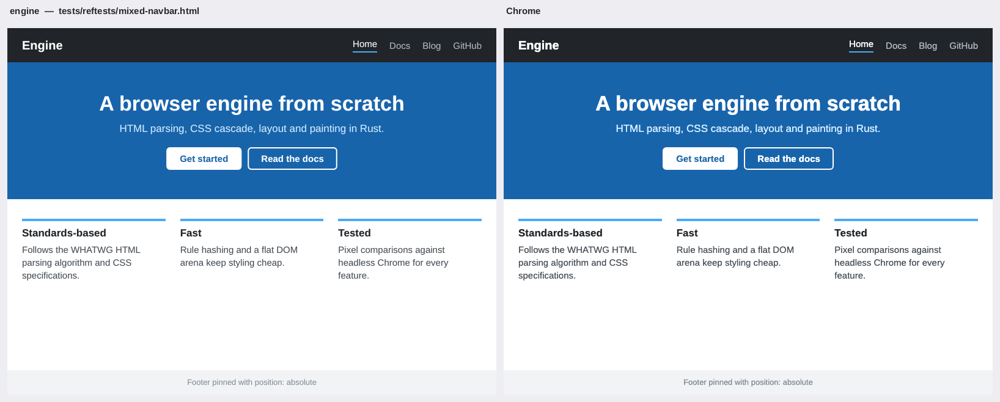
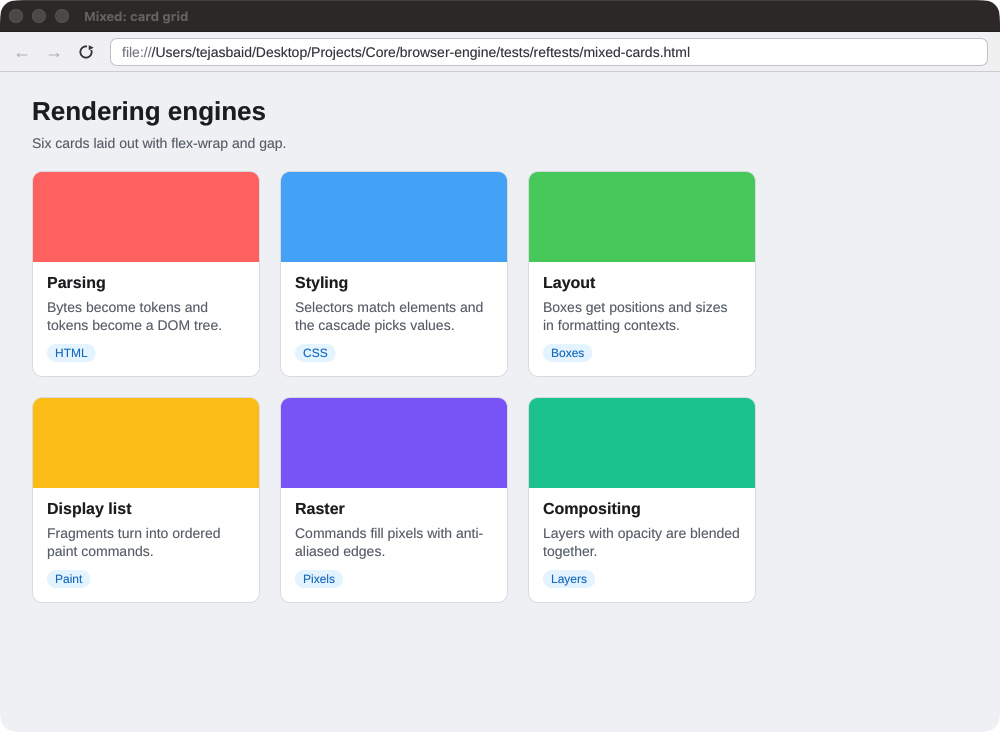
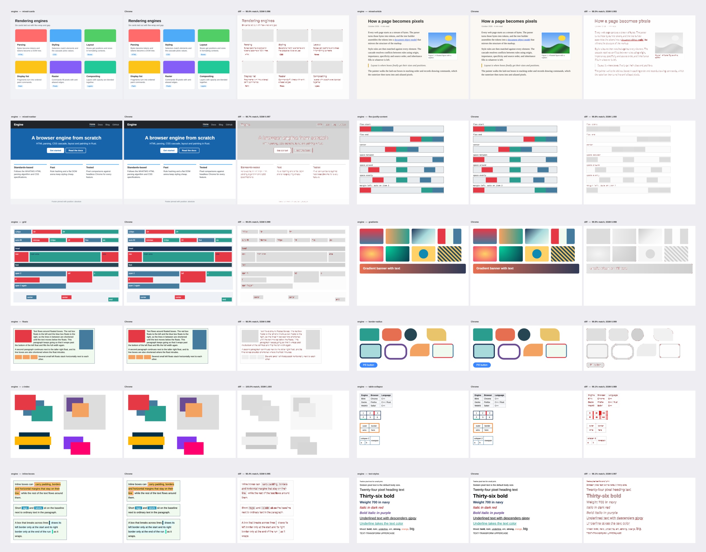
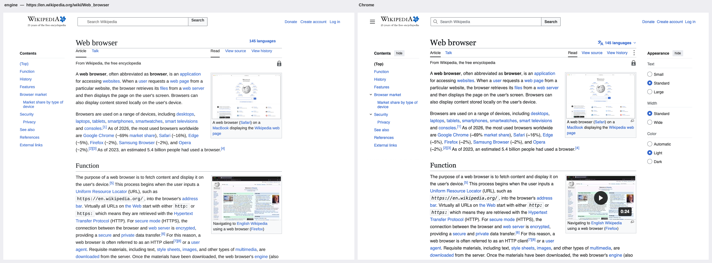
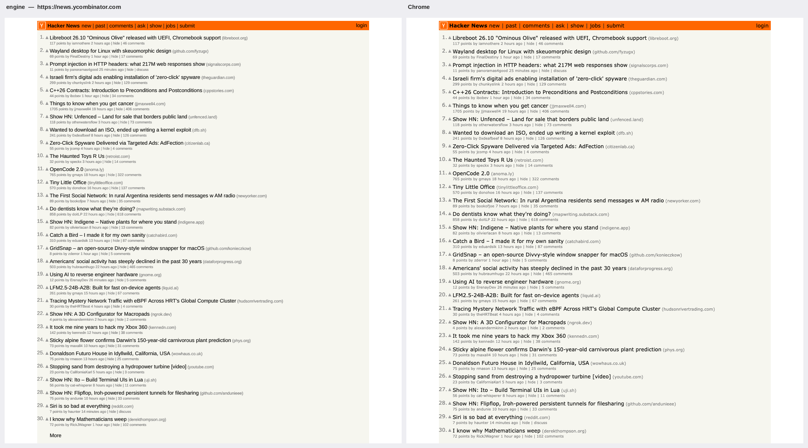
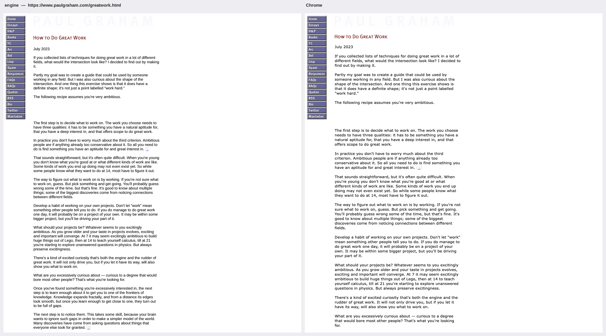
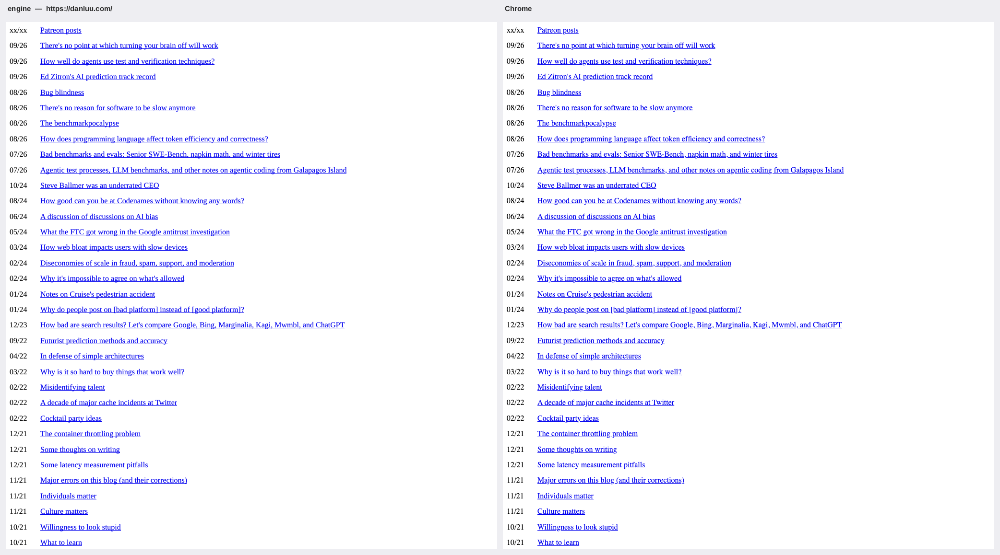

# browser-engine

A web browser engine written from scratch in Rust. HTML goes through a WHATWG-conformant tokenizer and tree
builder (**100% of the html5lib-tests tokenizer and tree-construction suites**), CSS through a CSS Syntax Level 3
tokenizer and parser, a selector engine and a full cascade, and the styled tree through hand-written block, inline,
float, positioned, flexbox, grid and table layout. The result becomes a display list in CSS stacking order and is
rasterized by a software painter with anti-aliased borders, rounded corners, shadows, opacity groups, clipping and
subpixel-positioned text. It renders to PNG from the command line, or in a small windowed browser with an address
bar, history, scrolling and clickable links. Rendered pages are compared pixel by pixel with headless Chrome:
across a 54-page reftest gallery the engine averages **99.4% pixel match** with Chrome (**96.3%**
over non-background pixels only, where text anti-aliasing differences show up). About 29k lines of Rust; no
JavaScript.



## Features

- **HTML.** The WHATWG tokenizer state machine (all ~80 states, RCDATA/RAWTEXT/script data/PLAINTEXT/CDATA,
  2,231 named character references, numeric references with the windows-1252 remapping) and the tree-construction
  stage: every insertion mode, implied end tags, head/body inference, foster parenting, the adoption agency
  algorithm, the Noah's Ark clause, templates, SVG/MathML foreign content with attribute and tag-name adjustment,
  quirks-mode detection, fragment parsing, and the 2025 customizable-`<select>` parser changes.
- **CSS syntax.** A CSS Syntax Level 3 tokenizer and parser with spec error recovery (invalid declarations and
  selectors are dropped without poisoning their neighbours), `!important`, `@media` (types, `and`/`or`/`not`,
  `min-`/`max-` and range syntax, `calc()` lengths), `@import`, `@supports`, `@font-face` (TTF/OTF web fonts).
- **Selectors.** Type, class, id, universal, all attribute operators with the `i`/`s` flags, the four
  combinators, `:first-child`, `:last-child`, `:only-child`, `:nth-child(an+b [of S])`, `:nth-last-child`,
  `:*-of-type`, `:not()`, `:is()`, `:where()`, `:root`, `:empty`, `:link`, `:checked`, `:disabled`, and
  `::before`/`::after`. Specificity follows Selectors Level 4 (`:is`/`:not` take their most specific argument,
  `:where` contributes zero).
- **Cascade and computed values.** A user-agent stylesheet modelled on the HTML rendering section (plus Chrome's
  quirks-mode additions), author sheets, presentational hints (`bgcolor`, `width`, `align`, `cellpadding`,
  `<font>`...), inline `style=""`, `!important` with correct origin ordering, inheritance, `inherit`/`initial`/
  `unset`, custom properties with `var()` (including inside shorthands), em/rem/%/px/pt/vw/vh/vmin/vmax, `calc()`,
  `min()`, `max()`, `clamp()`. Colors: 148 named colors, `#rgb[a]`/`#rrggbb[aa]`, `rgb()`/`rgba()`/`hsl()`/
  `hsla()`/`hwb()` (legacy and modern syntax), `light-dark()`, `currentcolor`, system colors.
- **Layout.**
  - Block formatting contexts with margin collapsing (siblings, parent/first and last child, empty boxes,
    negative margins), `box-sizing`, `min-`/`max-` sizes, auto-margin centering, percentage sizes.
  - Inline formatting contexts: line breaking on real glyph advances (rustybuzz shaping), whitespace processing
    for every `white-space` value, inline boxes with padding, borders and margins split across lines,
    `vertical-align` (baseline, sub, super, text-top/bottom, middle, top, bottom, lengths), `text-align`
    including `justify`, `text-indent`, `overflow-wrap`/`word-break`, `text-overflow: ellipsis`, `line-height`
    with Blink's rounding, and quirks mode's line-height rule.
  - Floats (left/right, stacking, shortened line boxes, clearance), and BFC roots that avoid floats.
  - `position: relative`, `absolute` and `fixed`, with containing blocks and static positions, and
    translation transforms (`translate()`, `translateX/Y()`, the offset of `matrix()`), which covers the common
    `left: 50%; transform: translate(-50%, -50%)` centering idiom.
  - `display: none | block | inline | inline-block | flow-root | list-item | contents` plus flex, grid and
    table values. List markers: disc, circle, square, decimal, alpha, roman, greek, strings, `start`/`reversed`/
    `value`.
  - Flexbox: direction, wrap (and reverse), `justify-content`, `align-items`/`align-self` (including baseline),
    `align-content`, grow/shrink/basis with the spec's freeze loop, automatic minimum sizes, `gap`, `order`, auto
    margins.
  - Grid: `grid-template-columns/rows` with `fr`, `minmax()`, `repeat()` (count, `auto-fill`, `auto-fit`),
    intrinsic tracks, named areas, line and span placement, sparse and dense auto-placement, implicit tracks,
    `gap`, `justify-items`/`justify-self`, `align-items`/`align-self`.
  - Tables: automatic layout from cell min/max-content widths, `colspan`/`rowspan`, percentage and fixed
    columns, `table-layout: fixed`, `border-spacing`, `border-collapse: collapse` (conflict resolution between
    adjacent cell and table borders, painted centred on the grid lines), captions (top and bottom), cell
    `vertical-align`.
  - `overflow` clipping, replaced elements (`` with intrinsic size, `width`/`height` attributes, aspect
    ratio, `object-fit`), `<video poster>`, simple form controls.
- **SVG (icons and logos).** Inline `<svg>`, `` and SVG background images: `viewBox` and
  `preserveAspectRatio`, paths (every command including arcs), rect/circle/ellipse/line/polyline/polygon, `<g>`,
  `<use>`, transforms, fill and stroke with opacity, `fill-rule` and `currentColor`. Shapes are flattened and filled
  by an anti-aliased scanline rasterizer.
- **Painting.** Backgrounds (colors, images with repeat/position/size, `linear-gradient()`, `radial-gradient()`
  and their `repeating-` forms, interpolated in premultiplied sRGB), borders (per-side widths, colors and
  styles: solid, dashed, dotted, double, inset, outset, groove, ridge) with `border-radius`, outer `box-shadow`,
  outlines, text with subpixel positioning in regular, bold, italic and bold italic faces, underline/overline/line-through
  (solid, dotted, dashed, double), images with bilinear filtering, `overflow` clips with rounded corners,
  `opacity` groups, and z-ordering by CSS 2.1 Appendix E stacking contexts.
- **Networking.** `file://`, `http(s)://` (ureq + rustls) and `data:` URLs, `<link rel=stylesheet>`, `@import`,
  ``, CSS background images and web fonts fetched in parallel, relative URL resolution with `<base>`, and
  UTF-8/windows-1252 decoding with `<meta charset>` sniffing.
- **Front ends.** A headless CLI (`render`, `dump-dom`, `dump-layout`, `bench`) and a windowed browser (`open`).

### Supported CSS

| Area | Properties |
|---|---|
| Box model | `display`, `width`, `height`, `min-*`, `max-*`, `margin*`, `padding*`, `box-sizing`, `aspect-ratio`, logical aliases (`margin-inline`, `inset-block`, ...) |
| Borders and backgrounds | `border*` (width, style, color, every shorthand), `border-radius` (elliptical), `background`, `background-color/image/repeat/position/size` (URLs, SVG and gradients), `box-shadow`, `outline*` |
| Positioning | `position`, `top/right/bottom/left`, `inset`, `z-index`, `float`, `clear`, `overflow`, `overflow-x/y`, `visibility`, `opacity`, `transform` (translation) |
| Text and fonts | `color`, `font`, `font-family`, `font-size` (keywords, `smaller`/`larger`), `font-weight`, `font-style`, `line-height`, `text-align`, `text-indent`, `text-transform`, `text-decoration*`, `white-space`, `overflow-wrap`, `word-break`, `text-overflow`, `letter-spacing`, `word-spacing`, `vertical-align` |
| Flexbox | `flex`, `flex-direction`, `flex-wrap`, `flex-flow`, `flex-grow/shrink/basis`, `justify-content`, `align-items`, `align-self`, `align-content`, `order`, `gap`, `row-gap`, `column-gap`, `place-*` |
| Grid | `grid-template-columns/rows/areas`, `grid-template`, `grid-auto-columns/rows/flow`, `grid-column`, `grid-row`, `grid-area`, `justify-items`, `justify-self` |
| Tables | `table-layout`, `border-collapse`, `border-spacing`, `caption-side`, plus the HTML table attributes |
| Lists and content | `list-style`, `list-style-type/position` (`list-style-image` falls back to the type), `content` (strings, `attr()`, quotes, `url()`, `counter()`, `counters()`), `counter-reset/increment/set`, `object-fit`, `cursor` |
| Values | lengths in px/pt/pc/in/cm/mm/em/rem/ex/ch/vw/vh/vmin/vmax and %, `calc()`/`min()`/`max()`/`clamp()`, `var()` with fallbacks, `inherit`/`initial`/`unset` (`revert` is treated as `unset`) |

## Architecture

```
  bytes ──► decode (UTF-8 / windows-1252, <meta charset>)
    │
    ▼
  tokens ◄── html::tokenizer         WHATWG state machine, pull-based; the tree builder
    │                                switches it into RCDATA / RAWTEXT / script data
    ▼
  DOM ◄───── html::tree_builder      insertion modes, adoption agency, foster parenting
    │                                → dom::Document (arena of nodes linked by NodeId)
    │          css::{tokenizer, parser, selector, media}  ◄── <style>, <link>, @import, style=""
    ▼
  styled tree ◄── style::cascade     rule index (id/class/tag buckets) → match → sort by origin,
    │                                importance, specificity, order → compute values (em, %, calc,
    │                                var(), inheritance) → Rc<ComputedStyle> per element, shared
    ▼
  layout tree ◄── layout::box_tree   boxes: anonymous blocks, flat inline item lists, markers,
    │                                ::before/::after, replaced elements, table structure
    │             layout::{block, inline, flex, grid, table, positioned}
    ▼                                → fragment tree (positions relative to parent)
  display list ◄── paint::display_list   CSS 2.1 Appendix E stacking order, clips, opacity groups
    │
    ▼
  pixels ◄── paint::raster           software rasterizer: snapped rects, AA rounded corners and
                                     borders, box-shadow blur, bilinear images, glyph masks
                                     → PNG (CLI) or a softbuffer window (GUI)
```

| Module | Responsibility |
|---|---|
| `dom/` | Arena DOM (`NodeId` links for parent/children/siblings), traversal, html5lib-format serializer |
| `html/` | `tokenizer.rs`, `tree_builder.rs`, generated `entities.rs` |
| `css/` | `tokenizer.rs`, `parser.rs` (rules, declarations, component values), `selector.rs` (parsing, specificity, matching), `values.rs` (lengths and `calc()`), `color.rs`, `gradient.rs`, `media.rs` |
| `style/` | `properties.rs` (longhand table, shorthand expansion, `var()`, computation), `cascade.rs`, `computed.rs`, `stylesheet.rs` (`@media`, `@import`, `@font-face`, `@supports`), `hints.rs` (presentational attributes), `grid.rs`, `ua.css` |
| `text/` | Font database and CSS font matching, metrics, shaping (rustybuzz), glyph rasterization (ab_glyph) |
| `layout/` | `box_tree.rs`, `block.rs` (BFC, margin collapsing, floats), `floats.rs`, `inline.rs`, `flex.rs`, `grid.rs`, `table.rs`, `positioned.rs`, `intrinsic.rs`, `fragment.rs` |
| `paint/` | `display_list.rs` (stacking contexts, hit regions for links), `raster.rs` |
| `svg.rs` | SVG parsing (through the HTML parser's foreign-content rules), path flattening, scanline fill |
| `page.rs`, `net.rs` | Loading pipeline, subresource discovery and parallel fetching, timings |
| `gui.rs` | winit + softbuffer browser window (feature `gui`, on by default) |
| `util.rs` | Fx hasher for the engine's internal hash maps |
| `bin/reftest.rs`, `imgdiff.rs` | Reftest runner, pixel match / SSIM, comparison and gallery images |

### Design decisions

**Arena DOM.** Nodes live in one `Vec` and refer to each other by index, so insertion, removal and re-parenting
(which the tree builder does constantly for foster parenting and the adoption agency algorithm) are O(1) and need
neither `Rc<RefCell<…>>` nor `unsafe`. The whole `Document` is `Send`, so the GUI can parse in a background thread.

**Inline content as a flat item list.** Each block container holds either block children or one inline
formatting context, stored as a flat sequence of text, `Start(box)`/`End(box)`, atomic, float and line-break
items. When a block appears inside an inline element, the open inline boxes are closed and reopened around it
with their split edges marked. Block-in-inline splitting becomes a builder detail, and the line breaker sees one
linear stream: it accumulates an unbreakable chunk between break opportunities and commits it to the current line
or starts a new one. Text is shaped once per item with rustybuzz (HarfBuzz's shaping model, which Chrome uses), so
widths include kerning.

**Margin collapsing up front.** Floats are placed in coordinates relative to the block formatting context, so a
box's final position has to be known before its children are laid out. Resolving collapsed margins afterwards
(the classic approach) would invalidate float positions. Instead, the collapsed top margin of a box (its own, its
first children's while they adjoin, and those of empty boxes they collapse through) is computed from styles
before placement, and the child then "absorbs" those margins. Bottom margins flow up as a returned margin strut.

**Relative fragment coordinates.** Fragments are positioned relative to their parent's border box. Flex items,
table cells and inline-blocks can be measured first and moved afterwards at O(1) cost. Absolutely positioned boxes
leave a placeholder at their static position during flow layout. A second pass walks the finished tree with
absolute coordinates, routes each placeholder to its containing block, lays the box out against the containing
block's final size, and attaches it there so it moves and paints with that block.

**Painting order is a display list concern.** The fragment tree stays in document order. The display list
builder applies CSS 2.1 Appendix E: per stacking context it paints background and borders, negative z-index
children, block backgrounds, floats, inline content, positioned descendants in tree order, then positive z-index
children. Clips are collected per layer, so a relatively positioned element inside `overflow: hidden` stays
clipped while an absolutely positioned one whose containing block is outside does not.

**Matching Chrome's arithmetic, not just its algorithms.** Getting pixel-level agreement took a handful of
Blink-specific details: font ascent, descent and line gap rounded separately (so `line-height: normal` of
16px Liberation Sans is 18px, not 18.4px), half-leading floored onto the ascent, lengths truncated to 1/64 px like
`LayoutUnit` (otherwise `.5` positions round the other way), Skia's underline offset, border widths floored to whole
pixels, `sub`/`super` shifts of `font-size/5 + 1` and `font-size/3 + 1`, the 13px default for `monospace`, and the
quirks-mode rule that inline boxes without text don't affect line height (which decides the row heights of
table-based pages like Hacker News). Glyph coverage goes through a luminance-dependent exponent fitted against
Chrome screenshots, which approximates Skia's text contrast on macOS.

**Style sharing.** Elements with the same parent style, the same matched rules and no inline style or
presentational hints share one `Rc<ComputedStyle>`. On the single-page HTML spec this cuts peak memory by about
20%. Rules are bucketed by the id, class or tag of their rightmost compound selector, so each element is only
tested against plausible rules.

**Crates only where they aren't the point.** Everything from bytes to pixels is hand-written except font file
parsing, shaping and glyph outline rasterization (`rustybuzz`, `ab_glyph`), image decoding (`image`), HTTPS
(`ureq` + rustls), URL parsing (`url`), the window (`winit` + `softbuffer`) and argument parsing (`clap`).
The bundled fonts are Liberation Sans, Serif and Mono (SIL OFL), which are metric-compatible with Arial, Times New
Roman and Courier New. Requests for those families, their common relatives and the CSS generic families resolve to
them.

## Quick start

```bash
cargo build --release

# Headless rendering
./target/release/browser render https://news.ycombinator.com --width 1024 --out hn.png --timings
./target/release/browser render page.html --width 800 --height 600 --out page.png
./target/release/browser render https://en.wikipedia.org/wiki/Web_browser --full-page --out wiki.png

# Debugging
./target/release/browser dump-dom https://example.com
./target/release/browser dump-layout tests/reftests/flex-wrap.html --width 800

# The windowed browser
./target/release/browser open https://en.wikipedia.org/wiki/Web_browser
./target/release/browser open            # built-in start page
```

The GUI draws its own toolbar (back, forward, reload, address field) with the engine's display list and text
renderer, loads pages on a background thread, re-lays out on resize, and renders at the display's scale factor.

| Key | Action |
|---|---|
| Cmd/Ctrl+L | Focus the address field (Enter navigates, Escape cancels) |
| Click a link | Navigate; same-page `#fragment` links scroll |
| Cmd+[ / Cmd+], Alt+←/→, mouse back/forward | History back / forward (scroll positions are remembered) |
| Cmd/Ctrl+R | Reload |
| Wheel, trackpad, arrows, Space, PageUp/PageDown, Home/End | Scroll |
| Cmd/Ctrl+W, Cmd+Q | Close |



`cargo build --no-default-features` builds a headless-only binary without the windowing dependencies.

## Testing

```bash
cargo test --release                                  # everything below
cargo run --release --bin reftest                     # score table against the stored Chrome screenshots
cargo run --release --bin reftest -- --images         # also write comparison images to docs/images/
scripts/reftest-chrome.sh                             # regenerate Chrome references (needs Chrome)
scripts/site-screens.sh                               # real-site comparisons (needs Chrome and network)
scripts/fetch-html5lib-tests.sh                       # re-download the pinned html5lib-tests
scripts/bench.sh                                      # performance (see below)
```

| Suite | What it checks |
|---|---|
| unit tests (`src/**`, 119) | tokenizers (tags, attributes, comments, doctype, character references, raw text states), tree builder (implied tags, adoption agency, foster parenting, quirks detection, foreign content, fragments), CSS parser error recovery, every selector type and specificity, the cascade (origins, `!important`, inline styles, inheritance, `var()`, media queries, presentational hints), values and colors, layout geometry for each mode (block widths, margin collapsing, inline wrapping, line height, inline boxes across lines, floats, BFC float avoidance, relative/absolute/fixed positioning, lists, flexbox grow/shrink/wrap/align, grid tracks/areas/auto-fill, tables, images, `vertical-align`, block-in-inline), the rasterizer (snapping, alpha, clips, opacity, rounded corners, per-side borders, scrolling) |
| `tests/html5lib.rs` | the html5lib-tests tokenizer and tree-construction suites (below) |
| `tests/pipeline.rs` | end to end: HTML string to pixels, canvas background propagation, link hit testing and URL resolution, scrolling with fixed elements, `dump-layout` |
| `tests/robustness.rs` | pushes all ~1,800 html5lib tree-construction inputs (deliberately malformed markup) through style, layout, display list and rasterization at two viewport sizes; nothing may panic |
| `tests/random_layouts.rs` | 400 deterministic pseudo-random documents mixing every display type, floats, positioning, flex and grid properties, negative/huge/percentage/`calc()` sizes and text; geometry must stay finite and nothing may panic (`RANDOM_CASES=4000` for a longer run) |
| `tests/reftests.rs` | renders all 54 reftest pages and requires each to stay within 1.5 points of its recorded pixel-match score against Chrome (uses the stored screenshots, so the tests don't need Chrome) |

`cargo fmt --check`, clippy with `-D warnings` (with and without the GUI feature) and rustdoc with
`-D warnings` are all clean.

### html5lib-tests

The suites are vendored from html5lib-tests commit `9329e64` (the last commit that still contains the
tree-construction tests; they have since moved to web-platform-tests).

| Suite | Passed | Notes |
|---|---:|---|
| Tokenizer | **7,028 / 7,028** (100%) | Each test runs once per initial state it lists. Token streams are compared; parse-error counts are not. 8 tests are skipped: 4 with lone surrogates that Rust strings cannot represent, and the 4 `xmlViolation` tests. |
| Tree construction | **1,792 / 1,792** (100%) | Document and `#document-fragment` tests, including SVG/MathML contexts. `#script-on` tests run with scripting enabled (which only affects `<noscript>`), and unmarked tests must pass in both modes. None are skipped. The `scripted/` tests need `document.write` and are not included. |

### Reftests

Each page in `tests/reftests/` exercises one feature area, fits in 800×600, and uses only the bundled fonts. Chrome
loads them through `@font-face`, so both engines rasterize the same font files. `scripts/reftest-chrome.sh`
renders the references with headless Chrome at device scale factor 1. Scores:

- **Pixel match** is the share of pixels whose largest channel difference is ≤ 16.
- **Content match** is the same measure, restricted to pixels that are non-white in at least one image, so large
  empty backgrounds don't inflate it.
- **SSIM** is the mean structural similarity of the luma channel over 8×8 windows.

Remaining differences are almost entirely glyph edge anti-aliasing: Chrome on macOS rasterizes text with CoreText,
the engine with ab_glyph. Box geometry matches exactly on nearly every page.

| Test | Pixel | Content | SSIM | | Test | Pixel | Content | SSIM |
|---|---:|---:|---:|---|---|---:|---:|---:|
|  `backgrounds` | 99.8% | 99.8% | 1.000  | |  `inline-wrapping` | 98.3% | 92.0% | 0.996  |
|  `block-auto-margins` | 100.0% | 100.0% | 1.000  | |  `line-height` | 98.7% | 91.7% | 0.997  |
|  `block-basic` | 100.0% | 100.0% | 1.000  | |  `lists-ol` | 99.1% | 96.8% | 0.998  |
|  `block-margin-collapse` | 100.0% | 100.0% | 1.000  | |  `lists-ul` | 99.0% | 95.9% | 0.992  |
|  `block-min-max` | 100.0% | 100.0% | 1.000  | |  `media-queries` | 99.3% | 97.8% | 0.998  |
|  `block-percentages` | 100.0% | 100.0% | 1.000  | |  `mixed-article` | 98.5% | 98.5% | 0.993  |
|  `border-radius` | 99.8% | 99.1% | 0.999  | |  `mixed-cards` | 98.6% | 98.1% | 0.996  |
|  `borders` | 100.0% | 99.8% | 1.000  | |  `mixed-navbar` | 98.7% | 97.7% | 0.997  |
|  `box-sizing` | 100.0% | 100.0% | 1.000  | |  `opacity` | 99.9% | 99.7% | 1.000  |
|  `cascade-specificity` | 99.1% | 98.1% | 0.998  | |  `overflow-hidden` | 99.7% | 98.7% | 0.999  |
|  `colors` | 99.8% | 99.3% | 1.000  | |  `position-absolute` | 100.0% | 100.0% | 1.000  |
|  `counters` | 99.5% | 78.9% | 0.999  | |  `position-fixed` | 99.9% | 99.4% | 1.000  |
|  `display-modes` | 99.4% | 94.8% | 0.998  | |  `position-relative` | 99.6% | 98.2% | 0.999  |
|  `flex-align` | 99.8% | 99.5% | 1.000  | |  `selectors-attribute` | 99.5% | 98.8% | 0.998  |
|  `flex-direction` | 99.9% | 99.8% | 1.000  | |  `selectors-combinators` | 99.2% | 97.3% | 0.998  |
|  `flex-gap-order` | 99.9% | 99.6% | 1.000  | |  `selectors-pseudo` | 99.5% | 98.3% | 0.999  |
|  `flex-grow-shrink` | 99.6% | 99.1% | 1.000  | |  `table-attributes` | 99.5% | 97.5% | 0.999  |
|  `flex-justify-content` | 99.8% | 99.5% | 1.000  | |  `table-basic` | 99.5% | 98.0% | 0.998  |
|  `flex-wrap` | 100.0% | 100.0% | 1.000  | |  `table-collapse` | 99.1% | 87.1% | 0.989  |
|  `float-clear` | 100.0% | 100.0% | 1.000  | |  `text-align` | 98.5% | 93.3% | 0.997  |
|  `floats` | 98.9% | 96.5% | 0.998  | |  `text-overflow` | 98.9% | 91.7% | 0.998  |
|  `font-families` | 98.7% | 97.0% | 0.998  | |  `text-styles` | 98.1% | 66.3% | 0.997  |
|  `gradients` | 99.9% | 99.7% | 0.998  | |  `ua-defaults` | 98.6% | 63.6% | 0.997  |
|  `grid` | 99.6% | 99.4% | 0.999  | |  `units` | 99.6% | 98.1% | 0.999  |
|  `images` | 99.2% | 99.2% | 0.998  | |  `vertical-align` | 99.4% | 99.1% | 0.996  |
|  `inheritance` | 99.2% | 97.7% | 0.999  | |  `white-space` | 99.2% | 95.9% | 0.999  |
|  `inline-boxes` | 98.4% | 94.8% | 0.995  | |  `z-index` | 100.0% | 100.0% | 1.000  |
| **mean of 54** | **99.4%** | **96.3%** | **0.998** | | | | | |

**Gallery** (engine | Chrome | diff, where red marks mismatched pixels; all 54 comparisons are in
[`docs/images/reftests/`](docs/images/reftests)):



### Real websites

These renders, side by side with headless Chrome at 1024px wide (light color scheme), come from
`scripts/site-screens.sh`. Neither renderer was tuned for these pages. Chrome runs their JavaScript; the engine
does not. Differences come from that, from icons drawn with CSS masks, from WOFF2 web fonts the engine can't load,
and from system fonts: Chrome on macOS uses Verdana, Helvetica and San Francisco, while the engine substitutes the
metric-compatible Liberation fonts where they exist.

**Wikipedia, 1280px** (Vector 2022's CSS grid layout and SVG wordmark; the right "Appearance" panel and the
collapsible-TOC arrows are created by JavaScript, and the icons are CSS masks):


**Hacker News** (table layout in quirks mode; the logo and vote arrows are SVG):


**Paul Graham's essays** (nested tables, `<font>`, spacer images; Verdana in Chrome, Liberation Sans here):


**danluu.com** (a plain blog):


example.com ([comparison](docs/images/sites/example.png)) renders its static paragraph correctly; the rest of
today's example.com page is injected by a script.

## Performance

`browser bench <url> --runs N` loads a page once (network and subresource fetching are excluded from the timings),
then repeats each pipeline stage N times and reports the median. Everything runs on one thread; only subresource
fetching is parallel. `scripts/bench.sh` wraps it: it takes a machine-wide lock so it never overlaps other
benchmarks, and refuses to run while the 1-minute load average is 4 or higher.

Release build on an Apple M4 (10 cores, 16 GB), `RUNS=5 scripts/bench.sh`, median of 5 runs. The 1-minute load
average was 1.90 before and 1.83 after; the remaining background load comes from ordinary desktop applications.

| | [HTML Living Standard](https://html.spec.whatwg.org/) (single page) | [Wikipedia: United States](https://en.wikipedia.org/wiki/United_States) |
|---|---:|---:|
| HTML size | 15.8 MB | 3.0 MB |
| Elements | 337,128 | 21,848 |
| Author style rules | 532 | 1,363 |
| Document height at 1024px | 2,503,296 px | 70,730 px |
| Display items | 431,904 | 20,622 |
| Parse HTML (tokenize + tree build) | 220.9 ms | 26.1 ms |
| Parse CSS | 1.6 ms | 6.3 ms |
| Style (matching, cascade, computed values) | 380.4 ms | 58.9 ms |
| Layout | 757.6 ms | 49.6 ms |
| Display list | 40.7 ms | 2.5 ms |
| Raster (1024×768 viewport) | 7.4 ms | 2.3 ms |
| **Total, bytes to first viewport** | **1.41 s** | **146 ms** |

HTML parsing runs at about 70 MB/s. Peak resident memory for a full render of the HTML spec, images included, is
about 900 MB. Raw output is in [`bench/results.txt`](bench/results.txt).

## Limitations

- **No JavaScript.** Scripts are ignored and `<noscript>` is parsed as markup, so script-built content is missing.
- **SVG is limited to static shapes:** no gradients, patterns, `<text>`, clipping, masks or filters in SVG, and
  stroke joins are always round.
- **CSS painting gaps:** transforms other than translation (rotate, scale, skew) are ignored; `filter`, masks,
  `conic-gradient()`, transitions and animations are not supported; only the topmost background layer is painted.
  Elements with `mask-image` (typically icon sprites) are skipped rather than painted as solid boxes.
- **Fonts:** TTF/OTF web fonts load; WOFF/WOFF2 don't. There is no font fallback for scripts the bundled fonts don't
  cover (CJK, emoji), no bidirectional text or vertical writing modes, and no hyphenation.
- **Layout gaps:** collapsed table borders ignore row and row-group borders and style precedence, grid has no
  subgrid or baseline alignment, there are no multi-column, `position: sticky` (laid out in place, without sticking),
  `::first-line`/`::first-letter`, inset shadows, or `:hover`/`:focus` states.
- **Forms** render as static boxes showing their value or placeholder; there is no text input or form submission.
- **GUI:** no tabs, clipboard, text selection or horizontal scrolling. The visible viewport is re-rasterized on
  every scroll step.
- **Memory:** computed styles are stored per element (shared where identical), so a 700k-node document like the
  single-page HTML spec peaks at about 900 MB of resident memory (with its images).

## License

MIT, see [LICENSE](LICENSE). The bundled Liberation fonts are under the SIL Open Font License 1.1
([assets/fonts/LICENSE-Liberation.txt](assets/fonts/LICENSE-Liberation.txt)); the vendored html5lib-tests are MIT
licensed ([tests/html5lib-tests/LICENSE](tests/html5lib-tests/LICENSE)).
